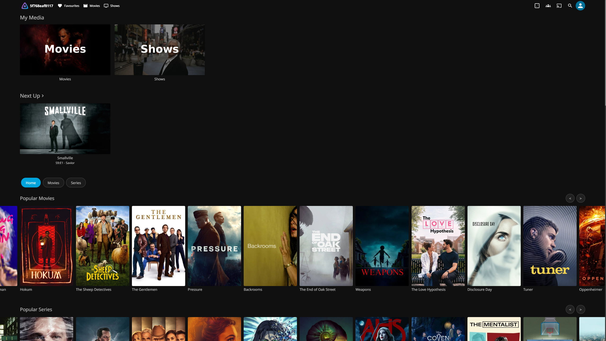
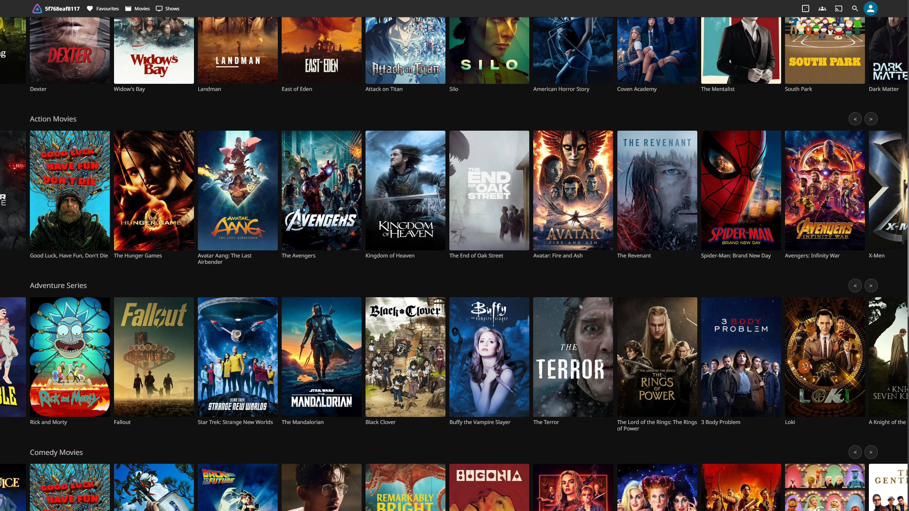

# Jellyfin Mediarow – Netflix-style Home Screen Plugin

**Jellyfin Mediarow is a Jellyfin plugin that turns the Jellyfin home screen into a Netflix-style streaming home page.** It adds horizontal Popular and genre rows with posters (Action, Comedy, Drama, Anime, and more) from Stremio catalogs such as Cinemeta or AIOMetadata. You can browse and stream them with native Jellyfin playback through AIOStreams, without importing a whole catalog into your library first.

> Built for Jellyfin 12 (.NET 10). Works in Jellyfin Web, the Android/iOS apps, Jellyfin Media Player, and TV apps such as Android TV, Tizen, webOS, Swiftfin and Findroid. See [Client support](#client-support).




## Why Mediarow?

Most Jellyfin streaming plugins either import an entire catalog into your library or only add search results. Mediarow is built around the **home screen**:

- **Netflix-style Home rows out of the box.** Popular Movies, Popular Series, Continue Watching and up to six genre rows on the Jellyfin home page. Rows are draggable, loop, and support filter tabs for Movies, Series and Anime. No Home Screen Sections or File Transformation plugin is needed.
- **No bulk import.** Rows are virtual. A title is only saved as a small `.strm`/`.nfo` item when you open it.
- **Native Jellyfin playback.** AIOStreams sources show up as normal Jellyfin versions with full labels (quality, size, source), with direct play, remux or transcode, and resume and watched status.
- **Fast.** Rows are warmed at startup and posters are cached. Movies are pre-probed so Play starts quickly. A whole series opens in about a second with every season and episode browsable, and Next Up is correct.
- **Stremio catalog support.** Use Cinemeta, AIOMetadata or any Stremio catalog addon, or TMDB/TVDB directly.

| | Mediarow | Original Dynamic Library | Gelato |
|---|:---:|:---:|:---:|
| Netflix-style Home screen rows | Yes | No | No |
| Browse without importing the catalog | Yes | Yes | No (bulk import) |
| Native Jellyfin playback for AIOStreams | Yes | Custom playback filter | Yes |
| Stremio catalog addons | Yes | Yes | Yes |

Mediarow is a fork of [pythcon/jellyfin-dynamic-library](https://github.com/pythcon/jellyfin-dynamic-library) (MIT). The series import approach was inspired by [lostb1t/Gelato](https://github.com/lostb1t/Gelato).

**Keywords:** Jellyfin Netflix home screen, Jellyfin home page plugin, Jellyfin home sections, Jellyfin Stremio plugin, Jellyfin AIOStreams, Jellyfin streaming catalog, Jellyfin genre rows.

## Prerequisites

- Jellyfin 12.0 or later
- At least one metadata source:
  - [TVDB API key](https://thetvdb.com/api-information) - for TV shows and anime
  - [TMDB API key](https://www.themoviedb.org/settings/api) - for movies
  - Stremio catalog addon URL (e.g., Cinemeta, AIOMetadata)
- (Optional) Stream provider for playback:
  - AIOStreams addon (recommended), OR
  - Embedarr instance, OR
  - Direct URL templates to your streaming service

## Installation

### From Plugin Repository (Recommended)

1. In Jellyfin, go to **Dashboard > Plugins > Repositories**
2. Click **Add** and enter:
   - **Repository Name:** Jellyfin Mediarow
   - **Repository URL:** `https://raw.githubusercontent.com/UserPhase/Jellyfin-MediaRow/gh-pages/manifest.json`
3. Click **Save**
4. Go to the **Catalog** tab and find "Jellyfin Mediarow"
5. Click **Install**
6. Restart Jellyfin

The repository URL becomes available after the first version-tagged release finishes building. A successful build on `main` only creates a workflow artifact; it does not publish a release or a manifest. See [Release Process](#release-process) if you maintain the repository.

If the plugin does not appear, open the repository URL in a browser: it must return JSON, not a GitHub page or a 404. Also check your server version: this release targets Jellyfin 12.0 and will be hidden on Jellyfin 10.x or 11.x. GitHub Pages is not required for the raw manifest URL above.

### Manual Installation

1. Download the latest release from [GitHub Releases](https://github.com/UserPhase/jellyfin-mediarow/releases)
2. Extract the ZIP to your Jellyfin plugins directory:
   - **Linux:** `/var/lib/jellyfin/plugins/Mediarow/`
   - **Docker:** `/config/plugins/Mediarow/` (mapped volume)
   - **Windows:** `C:\ProgramData\Jellyfin\Server\plugins\Mediarow\`
3. Restart Jellyfin

## Quick Start

1. Go to **Dashboard > Plugins > Jellyfin Mediarow**
2. Choose a **Catalog Provider**:
   - **Stremio Addon**: Enter a Stremio catalog URL (e.g., `https://v3-cinemeta.strem.io`)
   - **Direct**: Enter your TVDB and/or TMDB API keys
3. (Optional) Configure a **Stream Provider** for playback:
   - **AIOStreams**: Enter your AIOStreams addon URL
   - **Direct**: Configure URL templates
   - **Embedarr**: Enter your Embedarr instance URL
4. Under **Library & cleanup**, enable **library integration** for native AIOStreams playback; leave it off for virtual browsing only.
5. Save and restart Jellyfin
6. Search for any movie or TV show - results will include virtual items from the configured sources

## Features

### Keep only what you save

Under **Library & cleanup**, enable **Remove unsaved titles** and choose a grace period (default five minutes). The server removes idle, indexed Mediarow STRM/NFO files and library entries after browsing or playback; video files are not downloaded. Use Jellyfin's Favorite heart to retain a movie, series, season, or episode. A favorite from any user keeps the shared title. Active/paused playback, imports, and scans are protected.

Cleanup checks approximately once a minute, based on the last title activity reported by the client. An idle details page may expire because clients do not consistently report leaving it. Artwork and subtitles remain. This policy takes priority over watched-item cleanup. The standard server requests used by Jellyfin Media Player and Android TV renew activity; no client extension is required.

**Hide watched** affects recommendation rows and their **See All** pages, including native-client Latest rows. Search, library browsing, item details and Continue Watching remain available; parental and access restrictions still apply everywhere. **Not interested** has the same recommendation-only scope. In-progress movies remain visible until marked watched. Continuing shows, partially watched shows and shows with uncertain completion stay visible. An ended show is hidden only when a successful episode check from the last eight days supplies a complete inventory and every regular episode is imported, aired and watched by that user. Missing or stale inventory keeps it visible; no upstream requests are made while filtering rows.

The option uses a per-user movie identity index, including explicit mark-unwatched changes, retained in one compact `movie-watch-history.json` file. Removing temporary entries therefore preserves known watched identities. Previously deleted items with ambiguous numeric provider keys cannot be reconstructed reliably. Rows can be shorter or empty when most candidates are watched. This preference never deletes files; removal policies under Library & cleanup are separate.

To check the behavior on Web, Media Player or Android TV: enable Hide watched for one account, mark a movie watched, and verify it leaves the recommendation/Latest row but remains searchable and browsable. Mark it unwatched to restore it. A partially watched or continuing series must remain in rows; an ended series needs the complete verified inventory described above before it can disappear. Check Continue Watching and a second account separately. Native clients may need a Home refresh to discard already-rendered rows.

### Settings in Jellyfin Media Player

Sign in to the server with a Jellyfin administrator account, then open **User menu → Dashboard → Plugins → Jellyfin Mediarow**. Jellyfin Media Player loads the same server-provided configuration page as Jellyfin Web; no separate desktop plugin is required ([client documentation](https://github.com/jellyfin/jellyfin-media-player/blob/v1.11.1/README.md)).

The page has five sections: **Connections**, **Home rows**, **Library & cleanup**, **Language & subtitles**, and **Advanced & diagnostics**. All active server settings are editable here, including catalog rows, exact library paths, stream recovery, new-episode checks, per-user audio/subtitle priorities, remembered series choices, playback correction, and skip buttons. Expand the relevant provider or advanced section to edit it. Saving retains other users' preferences and settings belonging to inactive providers.

Use **Save settings** before running diagnostics or checking for new episodes; those actions use the saved server configuration. Server settings require administrator access. Personal Home options, including **Hide watched** and **Not interested**, are available through the Home preferences controls in the server-hosted web interface used by Jellyfin Media Player.

### Home row layout
- Home is a hybrid feed: separate Popular Movies and Popular Series rows, Continue Watching if enabled, and up to six selected genre rows interleaved across enabled categories in your configured genre order. Anime joins the rotation when enabled.
- Movies, Series, and Anime filter buttons display the full checked genre lineup for that category, without mixing content types. Disabled categories are not offered. Filters do not change ordinary Jellyfin library content.
- Choose Movies, Series, and Anime independently above the Home row list. Movies and Series are selected by default; Anime is opt-in and includes both anime movies and anime series.
- Check the rows you want and drag their `::` handles to arrange them. Up/Down buttons provide keyboard and mobile alternatives.
- Available genres include Action, Adventure, Drama, Comedy, Crime, Horror, Romance, Thriller, Science Fiction, Fantasy, Animation, Documentary, Mystery, Family, War, Western, and Music. Popular, Continue Watching, and Anime rows are also available, and you can add a custom genre.
- Genre availability and anime classification depend on your catalog provider's metadata. Western animation is not treated as anime just because it has an Animation genre.
- Save and return to Home to apply the layout without restarting Jellyfin. Unchecking every content category intentionally hides all virtual Home content; ordinary library content and search are unchanged.
- Drag posters sideways to browse Home rows. Overflowing rows loop seamlessly in either direction; previous/next buttons and the left/right arrow keys also work. Clicking a poster without dragging still opens its details.
- Jellyfin's own **Recently Added** row is moved below the Mediarow rows, because every title you open is persisted and would otherwise fill the top of Home. Other built-in sections such as My Media, Continue Watching and Next Up keep their position.

### Virtual Library Items
- Search returns results from your configured catalog source alongside your existing library
- Full metadata including posters, backdrops, cast, descriptions, and ratings
- Virtual items are distinguished by a `Mediarow` provider ID

### Dynamic Media Metadata
Dynamic items display rich metadata sourced from TMDB and Stremio addons:

| Field | TMDB Direct | Stremio |
|-------|:-----------:|:-------:|
| Poster / Backdrop | Yes | Yes |
| Logo | Yes | Yes |
| Tagline | Yes | Yes |
| Studios | Yes | Yes |
| Cast & Directors | Yes | Yes |
| Writers | Yes | Yes |
| Content Rating (e.g., PG-13) | Yes | — |
| Keywords / Tags | Yes | — |
| Countries | — | Yes |
| Status (Released, etc.) | Yes | Yes |

TMDB metadata is fetched in a single API call using `append_to_response` (credits, release_dates, keywords, and images).

### Catalog Providers
- **Stremio Addon**: Use Cinemeta, AIOMetadata, or any compatible Stremio addon
- **Direct APIs**: Query TVDB/TMDB directly for metadata

### Multiple Stream Providers
- **None**: Browse-only mode for metadata exploration
- **AIOStreams**: Use your configured AIOStreams Stremio addon for multi-source streaming with version selection
- **Embedarr**: Automatic STRM generation via Embedarr API
- **Direct**: Custom URL templates with placeholder support

### Persistent Library
- Optionally save virtual items as real Jellyfin library items (.strm files)
- Full playback tracking, watched status, and resume support
- Automatic detection of new episodes for ongoing series

### Anime Audio Versions
- Optional sub/dub track selection for anime content
- Configurable audio track options (e.g., "sub,dub")
- Works with Direct mode URL templates

### Automatic Subtitles
- Fetches subtitles from OpenSubtitles for virtual items
- Supports multiple languages
- Caches subtitles locally for performance

### Language Override
- Display metadata in your preferred language
- Supports 20+ languages via ISO 639-2/3 codes

### Audio & Subtitle Languages per User
- **Prefer original language** (on by default): AIOStreams results in the title's original language move to the top, so Smallville plays an English release instead of a Russian dub, and the original audio track is selected in multi-audio releases
- Every user gets their own settings, set by an admin under **Audio & Subtitle Languages**, for library videos and Mediarow streams alike. One user can watch everything in the original language with English subtitles, while another always gets German audio and no subtitles
- Audio: *the original language*, *specific languages* (in priority order), or *Jellyfin default*
- Subtitles: *when I don't understand the audio*, *always*, *forced only* (signs/songs), *off*, or *Jellyfin default*
- Per-series overrides (for example Japanese audio with English subtitles for one anime). **Series choices are remembered:** when a user changes the audio or subtitles during an episode, the next episodes of that series use the same tracks for that user (can be turned off per user). Remembered series are marked on the configuration page and can be edited or removed
- Tracks are chosen before playback starts, so the stream does not restart, and a track picked by hand always wins. For apps that ignore the server's choice, Mediarow switches tracks about 1.5 seconds after playback starts (can be turned off)
- Adapted from [Language Failover](https://github.com/Hightmar/jellyfin-langage-failover) by Hightmar (MIT). It replaces that plugin, so don't run both: each would switch tracks

### Skip Intro & Next Episode
- **Skip Intro / Skip Recap** buttons and a Netflix-style **Next Episode** prompt when the credits start. In Jellyfin Web the next episode starts after a 10-second countdown (the button fills up; pausing pauses it, **Hide** lets you watch the credits) instead of when the file ends. Needs **Play next episode automatically** in the user's playback settings
- **Android TV:** set the app's **Media segment actions → Outro** to **Skip** (playback settings). When the credits start, the app goes straight to its own Next Up screen, which starts the next episode after a short countdown. The default *Ask to skip* shows a Skip button for 8 seconds instead
- Intro, recap and credits times come from [AniSkip](https://aniskip.com) (anime), [TheIntroDB](https://theintrodb.org) and [IntroDB](https://introdb.app). No API keys, no scanning, and it works for Mediarow streams that never existed on disk
- Uses Jellyfin's standard media segments (Jellyfin 10.10 and newer), so Jellyfin Web, Android TV, Swiftfin, Findroid and other apps with segment support show the buttons. Markers from other plugins such as Intro Skipper always take priority
- Each user can set **Settings → Playback → Media segments** to skip automatically, ask (default) or do nothing
- Times are community-submitted and can be a few seconds off for a different release; episodes nobody has submitted yet fall back to Jellyfin's normal up-next prompt shortly before the end

## Configuration

Mediarow contains a self-contained Home runtime targeting Jellyfin 12.0 and .NET 10. It does not require separate Home Sections or File Transformation plugins for virtual rows, and it does not import the virtual catalog into Jellyfin's database.

## Virtual Home rows

Enable **Virtual Home rows** in the plugin configuration. The plugin registers Popular and configurable genre rows, including Action, Adventure, Comedy, Crime, Drama, Horror, Science Fiction, Thriller, Fantasy, Animation, Romance, Documentary, and Anime by default.

Rows are populated by the configured Mediarow provider and return the same complete `BaseItemDto` objects used by Mediarow search. Clicking a row item therefore follows the existing item lookup, metadata, image, stream, subtitle, and playback filters. Ranking uses available community ratings followed by year and name, with an optional deterministic shuffle and refresh interval.

Home rows are virtual. They do not require the catalog to be imported into a Jellyfin library. Enable persistence separately if selected movies or series should become real `.strm` library items and participate in Jellyfin's native Continue Watching and Next Up behavior.

When a series is opened for the first time, its catalog metadata is written into locked NFO files so Jellyfin's library scan does not query online providers for every episode. The series is imported directly instead of through a full library scan: like Gelato, the plugin builds every season and episode in memory with numbers, series links and catalog titles, plots and dates already set, and saves the whole tree at once. The details page opens within a second or two with all seasons and episodes browsable, and Next Up shows the first episode (or your real next episode) right away. If you stopped part-way through a later episode, Next Up (on the series page and in the Home Next Up row) shows that episode with your saved position instead of jumping back to the pilot. Once the scan finishes, the series and season NFOs are unlocked and refreshed in the background to add cast, logos and season posters. Episodes keep the catalog's titles, plots and stills.

Movies are imported the same way: the movie is created in the library with its catalog title, plot, rating and artwork as soon as its `.strm` is written, and online metadata (cast, logos) loads in the background. The AIOStreams lookup starts at the same moment, in parallel. A details page waits at most about one second for the stream list: if AIOStreams is slower on a title's first open, the page shows right away without the **Version** picker, and Play still uses the same lookup and your language rules. Stream lists are cached for five minutes, so reopening the title shows every version instantly. Once the list arrives, the best stream is probed in the background so Play has less to wait for.

Rows are prepared in the background when Jellyfin starts, so the first Home visit does not wait on the catalog addon. Rows that load at the same time share a single manifest and catalog request. Posters are cached in server memory for up to 12 hours and in the browser for a day. Failed catalog responses are not cached.

## Client support

Jellyfin clients fall into two groups, and Mediarow serves both:

| Client | What you get |
|---|---|
| Jellyfin Web (any browser), Android and iOS apps, Jellyfin Media Player / Desktop, Xbox | The full Netflix-style Home: filter tabs, looping rows, drag and touch scrolling, and remote/arrow-key navigation |
| Android TV, Tizen (Samsung), webOS (LG)\*, Swiftfin (iOS/tvOS), Findroid, Kodi (Jellyfin add-on) | Catalogs are exposed as app libraries (for example *Popular Movies* or *Drama Movies*). Home rows depend on the client's support and settings for "Latest" media; otherwise browse the libraries. |

\* Tizen and some webOS builds ship their own copy of Jellyfin Web, so the injected Home script can't run there. They use the app libraries instead.

How it works:

- **Injected Home (web-based clients).** The script is plain ES5 and the CSS avoids newer features such as flex `gap` and `:focus-visible` selector lists, so it runs on older TV browsers. Cards are focusable: Left/Right on a remote or keyboard moves between posters and wraps at the end of a row, Up/Down follows Jellyfin's normal spatial navigation, and Enter opens the title. On touch screens the rows use native swipe scrolling. Layouts adapt for phones and tablets and use Jellyfin's TV layout and safe-area insets.
- **App libraries (native clients).** With **Show rows in TV and native apps** enabled (the default), Mediarow adds one virtual library per configured row to `/UserViews`. Each library supports the standard Latest, Items (sorting, filtering, paging) and image endpoints. Opening a title imports it like a click on the web Home, so it plays with native Jellyfin playback. Nothing is added to your real libraries until a title is opened.
- The web client already shows the injected rows, so it hides these libraries by default (it is recognised by a cookie set with the injected page). Enable **Also list these libraries in the web client** if you want them there too.
- Playback from any client requires AIOStreams with persistence enabled. The first time a title is opened it takes about a second while it is imported. After that it opens instantly.

### Android TV feature check

Checked against the official Jellyfin Android TV app (current source) and a simulated Android TV session on Jellyfin 12:

| Feature | Android TV |
|---|---|
| Home rows | ✅ As app libraries (*Popular Movies*, *Drama Movies*, …) with native "Latest" rows on Home |
| Search | ✅ Catalog movies and series appear in the app's normal search |
| Playback (AIOStreams) | ✅ Native player. Streams direct-play when the TV supports the codecs, including PGS subtitles |
| Continue Watching / Next Up / resume position | ✅ Server-side, the same as on the web |
| Per-user audio & subtitle languages | ✅ Applied before playback starts. The app remembers the last language you picked by hand and prefers it, so keep **Correct tracks after playback starts** on to get each user's settings back |
| Remembered series choices | ✅ The app reports track changes, so they are learned the same way as on the web |
| Skip Intro / Skip Credits | ✅ The app's own skip prompt, using Mediarow's segments. Skipping the credits goes straight to the app's Next Up screen. Set **Media segment actions → Outro** to **Skip** to do this automatically when the credits start, Netflix-style |
| Skip Recap | ⚙️ Off by default in the app: enable it in the app's playback settings under **Media segment actions** |
| Netflix-style player buttons, filter tabs, looping rows | ❌ Web only: Android TV is a native app and uses its own player and Home screen |

### Libraries visible but no Home rows

Version 2.0.2 also fixes configuration loading in embedded browsers without `replaceChildren()`: the Home genre checkboxes and Stremio Addon URL can otherwise remain unavailable. Until updated, configure the plugin through your server's browser dashboard; the settings apply to all clients.

The Popular/genre library tiles are the native-client fallback, not the custom Home rows. Mediarow cannot force a native or bundled client to render a custom Home layout. Enable that client's Latest media/Home sections if available; some clients will only show the libraries. Real-device support is not yet verified for every client listed above.

For the full custom rows, open the web interface served by your Jellyfin server (not a separately hosted or bundled web client):

1. Restart Jellyfin after installing or updating the plugin, then hard-refresh the browser or clear the cached Jellyfin site data.
2. In Mediarow settings, enable **Virtual Home rows**, configure a catalog provider, and leave **Also list these libraries in the web client** off to avoid duplicate library tiles.
3. View the Home page's HTML source and look for `mediarow-home.js`. If it is missing, the page is not receiving the injected assets. If it is present, check the browser Network/Console for failed script, stylesheet or `Mediarow/Home/Sections` requests.
4. If using a Jellyfin Base URL such as `/jellyfin`, the script and stylesheet URLs must include that prefix. Version 2.0.2 fixes asset injection for these installations.

### General Settings

| Setting | Default | Description |
|---------|---------|-------------|
| `Enabled` | true | Enable/disable the plugin |
| `CacheTtlMinutes` | 60 | How long to cache API responses |

### Catalog Provider


| Setting | Options | Description |
|---------|---------|-------------|
| `CatalogProvider` | StremioAddon, Direct | Source for metadata and search results |

| `StremioCatalogUrl` | - | Stremio addon URL (when using StremioAddon mode) |

**Stremio Addon Examples:**
```
# Cinemeta (official Stremio catalog)
https://v3-cinemeta.strem.io


# AIOMetadata (your configured instance)
https://your-aiometadata-instance.com/xxxxx
```

### Direct API Settings (when CatalogProvider=Direct)

| Setting | Description |
|---------|-------------|
| `TvdbApiKey` | TVDB v4 API key for TV shows and anime |
| `TmdbApiKey` | TMDB v3 API key for movies |
| `MovieApiSource` | API source for movies: None, TMDB, or TVDB |
| `TvShowApiSource` | API source for TV shows: None, TVDB, or TMDB |
| `MaxMovieResults` | Maximum movie search results (default: 20) |
| `MaxTvShowResults` | Maximum TV show search results (default: 20) |

### Stream Provider

| Setting | Description |
|---------|-------------|
| `StreamProvider` | None (browse only), AIOStreams, Embedarr, or Direct |

#### AIOStreams Settings

| Setting | Description |
|---------|-------------|
| `AIOStreamsUrl` | Full AIOStreams addon URL including encrypted config (e.g., `https://aiostreams.elfhosted.com/E2_xxxxx`) |
| `PreferOriginalLanguageStreams` | Default `true`. Sorts results in the title's original language first and selects the original audio track. Users with their own language preferences use their lists instead |

AIOStreams playback uses Jellyfin's native media-source and player pipeline, not a raw browser redirect. Enable persistence and automatic scans, set the **Movies path**, **Series path** and **Anime path**, then add those exact folders as Movies/Shows libraries. Mediarow does not append category subfolders to these settings.

The virtual Popular/genre libraries do not satisfy this requirement: add the filesystem folders under **Dashboard > Libraries**. Each path must be visible and writable inside the Jellyfin server (inside the container if using Docker), not merely on the client computer. For example, Movies path `/media/films` and Series path `/media/shows` need real library locations `/media/films` and `/media/shows`.

If every poster reports that it could not be opened, version 2.0.3 displays the server's specific error instead of replacing it with a generic persistence warning. Check that error before changing addon settings: configuration validation can fail before the addon is queried. Do not share addon URLs, API keys or access tokens when reporting an error.

Opening a virtual title enriches its metadata, saves small `.strm` and `.nfo` files, and waits for Jellyfin to assign a real library ID. Series episodes are populated before creation. Existing matching library titles are reused rather than overwritten.

Stream choices retain the addon's order, except that language preferences move matching releases up: unlabeled and multi-language releases keep their place, and releases tagged only with other languages move to the bottom. Only HTTP(S) media URLs are supported; torrent/info-hash-only and external-player entries are skipped. `notWebReady` is not treated as a reason to discard a stream: Jellyfin probes the selected file and can remux/transcode it. Streams requiring `behaviorHints.proxyHeaders.request` use a private, loopback-only relay because Jellyfin 12's probe does not forward all HTTP headers. The relay supports byte ranges and rewrites HLS playlist/segment/key URLs. Response headers intended for an addon proxy are not applied as request headers.

Streams cache for five minutes (empty results for 30 seconds), with isolation by addon configuration. The selected source is probed on opening; real audio/video/subtitle indexes, codecs, duration, and bitrate drive playback decisions. Initial probing uses a three-second media-analysis window and a 30-second request timeout so large remote files do not inherit excessively long server analysis defaults. The three-second window also applies when Jellyfin transcodes that opened source, preventing delayed HLS segments. Global settings and unrelated library sources are unchanged. Probe results cache for six hours, and opening a persisted title's details page warms the probe in the background so Play starts quickly. Changing addon configuration or stream URL does not reuse unrelated media information.

If a stream expires, reload the title after the cache expires. Missing configuration, unavailable streams, scan delays, and probe failures produce explicit errors rather than navigating to a success-looking but unplayable item. Addon URLs can contain secrets: do not paste them into public logs or issues.
`EnableHlsProbing` is retained for configuration compatibility; it does not disable native AIOStreams probing. Selected sources, including HLS, must be probed before playback can be negotiated safely.

#### Local playback testing

The local-only addon fixture in `tests/fixtures/aiostreams-addon.cjs` accepts a folder containing original generated test media: `compatible.mp4` (H264/AAC), `surround.mkv` (H264/AC3 5.1), and optionally `playlist.m3u8` plus its segments. It does not download media or require provider credentials.

```powershell
node .\tests\fixtures\aiostreams-addon.cjs 'C:\path\to\generated-media'
```

Use `http://127.0.0.1:18766/manifest.json` as the temporary AIOStreams URL and `http://127.0.0.1:18766` as the temporary catalog URL. Add separate temporary Movies and Shows libraries for the persistent `movies` and `tv` folders. The fixture exposes movies and two episodes, ordered MP4/MKV/HLS choices, byte ranges, and Referer-protected MKV/HLS media.

Check Home-to-native-item navigation, version selection, seeking, episode numbering, next-episode playback, and Jellyfin watch state. For transcoding, verify actual playback as well as FFmpeg output. An embedded browser can reject an audio decoder configuration even when probing and transcoding succeed; reproduce with an ordinary local Jellyfin file before treating that as an addon integration failure. Restore the original configuration, remove the temporary libraries, and stop the fixture afterward.

#### Embedarr Settings

| Setting | Description |
|---------|-------------|
| `EmbedarrUrl` | Embedarr instance URL |
| `EmbedarrApiKey` | Embedarr API key (if required) |
| `CreateMediaOnView` | Pre-trigger Embedarr when viewing item details (default: false) |

#### Direct URL Templates

| Setting | Description |
|---------|-------------|
| `DirectMovieUrlTemplate` | URL template for movie streams |
| `DirectTvUrlTemplate` | URL template for TV show streams |
| `DirectAnimeUrlTemplate` | URL template for anime streams |
| `ShowUnreleasedStreams` | Generate stream URLs for unreleased content (default: false) |

**Template Placeholders:**

| Placeholder | Description |
|-------------|-------------|
| `{id}` | Preferred provider ID based on config |
| `{imdb}` | IMDB ID (tt1234567) |
| `{tmdb}` | TMDB ID |
| `{tvdb}` | TVDB ID |
| `{anilist}` | AniList ID (anime only) |
| `{season}` | Season number |
| `{episode}` | Episode number |
| `{absolute}` | Absolute episode number |
| `{audio}` | Audio track (sub/dub) |
| `{title}` | URL-encoded title |

**Example Templates:**
```
# Movies
https://stream.example.com/movie/{imdb}

# TV Shows
https://stream.example.com/tv/{imdb}/{season}/{episode}

# Anime with audio selection
https://stream.example.com/anime/{anilist}/{episode}?audio={audio}
```

### Provider ID Preferences

Control which ID is used for stream lookups:

| Setting | Options | Default |
|---------|---------|---------|
| `MoviePreferredId` | IMDB, TMDB | IMDB |
| `TvShowPreferredId` | IMDB, TVDB | IMDB |
| `AnimePreferredId` | IMDB, TVDB, AniList | IMDB |

### Anime Audio Versions

| Setting | Default | Description |
|---------|---------|-------------|
| `EnableAnimeAudioVersions` | false | Show audio track selector for anime |
| `AnimeAudioTracks` | "sub,dub" | Comma-separated track options |

### Language Settings

| Setting | Options | Description |
|---------|---------|-------------|
| `LanguageMode` | Default, Override | Default uses original language from API |
| `PreferredLanguage` | ISO 639-2 code | Language code (eng, jpn, spa, fra, deu, etc.) |

### Audio & Subtitle Languages

| Setting | Default | Description |
|---------|---------|-------------|
| `UserLanguagePreferences` | empty | Per user: `AudioLanguages` and `SubtitleLanguages` (ISO 639-2 codes in priority order), `PreferOriginalAudio`, `SubtitleMode` (`Default`, `WhenNeeded`, `Always`, `ForcedOnly`, `Off`), `PreferNonForcedSubtitles`, `PreferForcedWhenAudioMatches`, `RememberSeriesChoices`, and `SeriesOverrides` (each with optional `SubtitleMode`/`PreferOriginalAudio` and a `Learned` flag for remembered choices). Edit them on the configuration page |
| `CorrectTracksAfterPlaybackStart` | true | Sends a track switch after playback starts when an app ignored the server's choice |

With `WhenNeeded`: when the audio is in a subtitle language that ranks at least as high as any subtitle on offer, subtitles are turned off, or forced subtitles in that language are shown when `PreferForcedWhenAudioMatches` is on. Otherwise the highest-ranked subtitle language is used, preferring full over forced subtitles. Empty lists leave that track type to Jellyfin.

### Skip Intro & Next Episode

| Setting | Default | Description |
|---------|---------|-------------|
| `EnableOnlineSkipSegments` | true | Adds intro, recap and credits markers from AniSkip, TheIntroDB and IntroDB to episodes without markers of their own |
| `NetflixStylePlayerButtons` | true | Netflix-style skip button and next-episode card in Jellyfin Web; the next episode starts 10 seconds after the credits begin (reload the page after changing) |

### Subtitle Settings

| Setting | Default | Description |
|---------|---------|-------------|
| `EnableSubtitles` | false | Enable automatic subtitle fetching |
| `OpenSubtitlesApiKey` | - | API key from [OpenSubtitles](https://www.opensubtitles.com/consumers) |
| `SubtitleLanguages` | "en" | Comma-separated ISO 639-1 codes (e.g., "en,es,fr") |
| `MaxSubtitlesPerLanguage` | 1 | Maximum subtitles to download per language |
| `UseJellyfinOpenSubtitlesCredentials` | true | Use credentials from Jellyfin's OpenSubtitles plugin |
| `SubtitleCachePath` | /tmp/jellyfin-mediarow-subtitles | Local path for cached subtitle files |

### Persistence Settings

Enable persistence to save virtual items as real Jellyfin library items with full playback tracking.

| Setting | Default | Description |
|---------|---------|-------------|
| `EnablePersistence` | false | Enable persistent library items (.strm files) |
| `MoviesLibraryPath` | Legacy root + movies | Exact destination for generated movies; add as a Movies library |
| `SeriesLibraryPath` | Legacy root + tv | Exact destination for generated series; add as a Shows library |
| `AnimeLibraryPath` | Legacy root + anime | Exact destination for generated anime series; add as a Shows library if enabled |
| `PersistentLibraryPath` | /mediarow | Legacy fallback retained for older configurations; no longer edited in the UI |
| `TriggerLibraryScan` | true | Automatically scan library after creating new items |
| `CreateUnreleasedMedia` | false | Create media for unreleased content |
| `CheckForUpdatesOnView` | true | Check for new episodes when viewing persisted series |
| `CleanupWatchedMovies` | false | Remove generated movie STRM/NFO files and library entries after all enabled users with access have watched |
| `CleanupCompletedSeries` | false | Remove a generated series only when Jellyfin metadata marks it Ended and all episodes are watched by all enabled users with access |

**Setting Up Persistence:**

1. Enable `EnablePersistence` in plugin settings
2. Set **Movies path**, **Series path** and **Anime path** to exact absolute writable server folders (e.g., `/media/films` and `/media/shows`, or `D:\Media\Movies` and `D:\Media\Series`)
3. Add the exact Movies path as a Movies library and the Series/Anime paths as Shows libraries; keep automatic library scanning enabled
4. When you click on a virtual item, it creates a .strm file in this folder
5. The new item is added straight into that library (no full library scan) with full tracking; a library scan is only used as a fallback when the folder is not directly a library path

Existing root-based settings retain their original destinations: the new fields initially display the legacy root plus `movies`, `tv` and `anime`. Saving stores those explicit paths. Changing a path does not move existing items, and cleanup only considers items in the currently configured folders. The plugin does not automatically register Jellyfin libraries.

### Optional watched-item cleanup

In Mediarow settings, enable **Remove Mediarow movies after watching** and/or **Remove fully watched, ended Mediarow series**. Both switches are **off by default**; enabling them also applies to existing eligible Mediarow items.

The **Mediarow: Clean Up Watched Items** scheduled task runs hourly, or can be run manually under **Dashboard > Scheduled Tasks**. It uses Jellyfin's watched flag, including items manually marked watched, rather than assuming that stopping playback means completion. It waits for every enabled user with access, skips favorites and active/paused playback, and leaves files modified in the last ten minutes until a later run.

Series must have a confirmed **Ended** status, every imported episode (including specials) watched, and no future or unknown episode air dates. Continuing/unknown-status series are never purged. If the metadata provider cannot confirm that a series has ended, it stays in the library.

Cleanup is restricted to immediate title folders under the configured Movies, Series and Anime paths. Every STRM must contain a Mediarow marker (including the legacy marker) and match an indexed library item. Mixed folders with real media, unindexed streams, or symlinks/junctions are refused. Only generated STRM files, their companion NFOs and series/season NFOs are removed; artwork, subtitles and other NFOs are preserved. Empty title/season directories are removed without deleting library roots.

The shared library entry is removed too, so a repeat viewing requires opening the virtual catalog title again to reimport it. This is not a watch-history backup feature; use Jellyfin's normal user-data backup or external watch tracking if retaining history is essential.

## How It Works

```
Search Query
    |
    v
SearchActionFilter intercepts request
    |
    v
Query catalog source (Stremio addon or TVDB/TMDB)
    |
    v
Create virtual BaseItemDto objects with unique GUIDs
    |
    v
Cache items in memory
    |
    v
Return results to Jellyfin UI
    |
    v
User clicks item -> ItemLookupFilter returns cached DTO
    |
    v
(Optional) PersistenceService creates .strm files
    |
    v
User plays item -> AioStreamsPlaybackFilter + DynamicAioStreamsMediaSourceProvider resolve AIOStreams sources
    |
    v
(Optional) SubtitleFilter serves cached subtitles
```

Virtual items use deterministic GUIDs generated from a unique prefix (kept from the original project so existing item IDs stay stable) to prevent collisions with real library items.

## Known Limitations

- Virtual items (without persistence) are ephemeral and exist only in memory cache
- Playback requires a configured stream provider (AIOStreams, Embedarr, or Direct URLs)
- Some metadata may be incomplete depending on API availability
- Episode translations may not be available for all languages in TVDB
- Android TV may have quirks with version selection (the plugin includes workarounds)

## Troubleshooting

### Version Selection Not Working on Android TV
The plugin includes workarounds for Android TV's version selection quirks. If you're still experiencing issues, try:
1. Clear the Jellyfin app cache on Android TV
2. Ensure you're on the latest plugin version

### Playback Fails Immediately
1. Check that your stream provider is correctly configured
2. For AIOStreams, verify your addon URL is valid and not expired
3. For Direct mode, ensure URL templates include all required placeholders

### Missing Subtitles
1. Verify OpenSubtitles API key is correct
2. Check that the language codes in `SubtitleLanguages` are valid ISO 639-1 codes
3. Subtitles may not be available for all content

## Support

- **Issues:** [GitHub Issues](https://github.com/UserPhase/jellyfin-mediarow/issues)
- **Discussions:** [GitHub Discussions](https://github.com/UserPhase/jellyfin-mediarow/discussions)

## Development

### Building Locally

```bash
dotnet build Jellyfin.Plugin.Mediarow/Jellyfin.Plugin.Mediarow.csproj -c Release
```

### Local Testing

```bash
dotnet test tests/Jellyfin.Plugin.Mediarow.Tests/Jellyfin.Plugin.Mediarow.Tests.csproj
node --test tests/home-layout.test.cjs tests/home-carousel.test.cjs tests/home-hybrid.test.cjs tests/home-preferences.test.cjs tests/next-episode.test.cjs
```

To try it in Jellyfin, copy `Jellyfin.Plugin.Mediarow/bin/Release/net10.0/Jellyfin.Plugin.Mediarow.dll` into `<jellyfin data>/plugins/Mediarow/` and restart Jellyfin.

### Release Process

1. Update the version in `Jellyfin.Plugin.Mediarow/Jellyfin.Plugin.Mediarow.csproj` and `build.yaml`:
   ```xml
   <Version>X.Y.Z</Version>
   <AssemblyVersion>X.Y.Z.0</AssemblyVersion>
   <FileVersion>X.Y.Z.0</FileVersion>
   ```

2. Commit changes:
   ```bash
   git add -A && git commit -m "Bump version to X.Y.Z"
   ```

3. Create and push version tag:
   ```bash
   git tag vX.Y.Z && git push && git push --tags
   ```

4. GitHub Actions will automatically:
   - Build and test the plugin
   - Create a GitHub Release with `mediarow-X.Y.Z.zip`
   - Create or update `manifest.json` on the `gh-pages` branch

The workflow uses the repository it runs in, so a fork publishes its own release links. A push to `main` alone does not publish the plugin repository: a version tag such as `v2.0.0` must be pushed. Wait for both the `build` and `update-manifest` jobs to succeed, then verify the release ZIP is attached and `https://raw.githubusercontent.com/<owner>/<repository>/gh-pages/manifest.json` returns JSON. Add that raw URL under **Dashboard → Plugins → Repositories** in Jellyfin; no GitHub Pages setup is necessary.

If you prefer a Pages URL, enable GitHub Pages for the `gh-pages` branch at `/` in repository settings. Use the exact repository-name casing in `https://<owner>.github.io/<repository>/manifest.json`.

## License

MIT - See [LICENSE](LICENSE) file for details. Based on [jellyfin-dynamic-library](https://github.com/pythcon/jellyfin-dynamic-library) by pythcon. Per-user language preferences are adapted from [Language Failover](https://github.com/Hightmar/jellyfin-langage-failover) by Hightmar (MIT). Intro and credits times are provided by the AniSkip, TheIntroDB and IntroDB communities.
